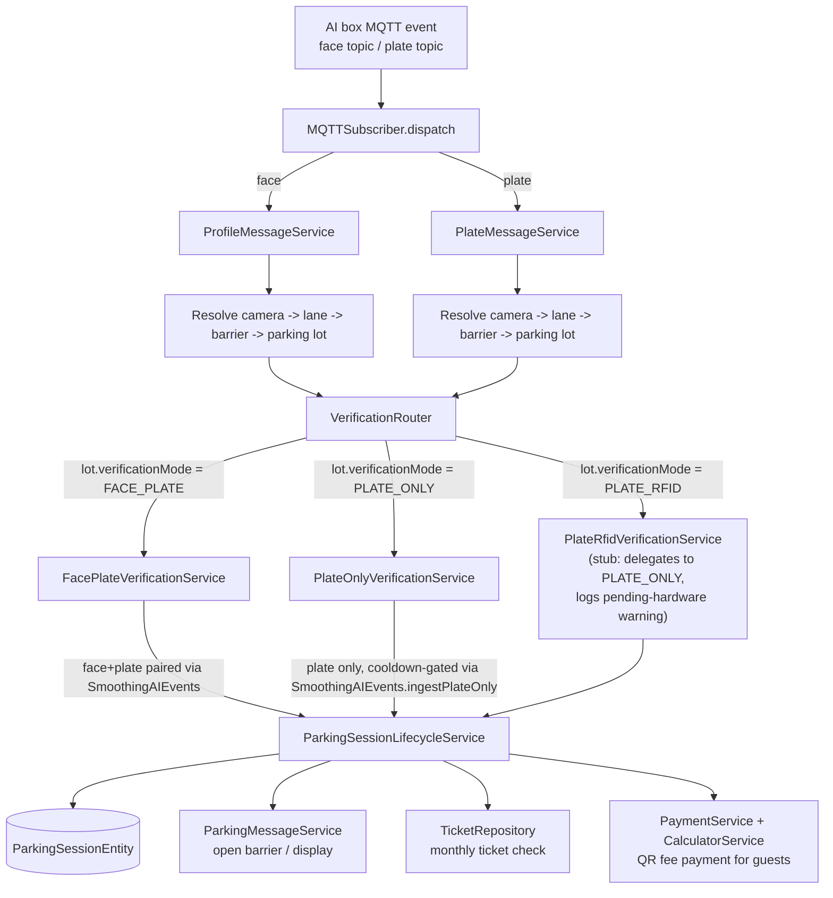
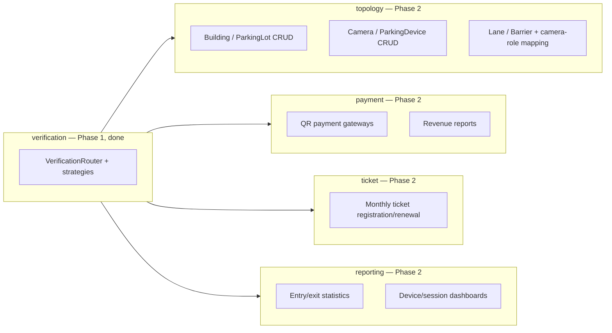

# Verification architecture

## Why

Guest ("khách vãng lai") vehicles were previously forced through the same
**face + plate** verification flow as everyone else, even though:

- Most competing systems don't solve two-factor (plate + face) verification for
  walk-in customers either.
- PMS already requires guests to pay by QR at checkout, which itself leaves an
  auditable trail (invoice, timestamp, gateway reference) usable for
  investigation if a vehicle is disputed or reported stolen.

Forcing face capture on every guest lane slows go-to-market for sites that
don't need that extra step. At the same time, face recognition/tracking stays
a real product direction for security and access-control use cases — it just
shouldn't be a hard dependency for every parking lot.

**Phase 1** (this change) makes verification a **per-parking-lot setting**
instead of a global hard-coded flow, and introduces a routing core so new
verification methods (RFID, badge, etc.) can be added later without touching
the lots that don't need them.

## Phase 1 — what's built



Key pieces (package `vio.barie.core.verification`):

| Class | Responsibility |
|---|---|
| `VehicleVerificationService` | Interface every strategy implements: `onFaceEvent`, `onPlateEvent`, `getMode()`. |
| `VerificationRouter` | The "core" — resolves a parking lot's `verificationMode` and forwards the event to the matching strategy bean. |
| `ParkingSessionLifecycleService` | Shared, mode-agnostic session logic: open entry, close exit, monthly-ticket lookup, fee calculation, payment-QR creation. `customer` is nullable — null whenever the active strategy doesn't use face identity. |
| `strategy.FacePlateVerificationService` | `FACE_PLATE` (default): waits for a paired face+plate detection (`SmoothingAIEvents`), and additionally requires the exit face to match the entry face. |
| `strategy.PlateOnlyVerificationService` | `PLATE_ONLY`: plate alone opens/closes the barrier; face events are received but ignored for gating. |
| `strategy.PlateRfidVerificationService` | `PLATE_RFID`: extension seam for future RFID hardware — no reader integration exists yet, so it currently behaves like `PLATE_ONLY` and logs a warning. |

### Admin API

`ParkingLotEntity.verificationMode` (enum `FACE_PLATE` / `PLATE_ONLY` /
`PLATE_RFID`, default `FACE_PLATE`, migration `V43`) is set via:

```
PATCH /api/parking-lots/{id}/verification-mode
{ "verificationMode": "PLATE_ONLY" }
```

It can also be set at creation/update time through the existing
`POST /api/parking-lots` / `PUT /api/parking-lots/{id}` body
(`verificationMode` field, optional — defaults to `FACE_PLATE`).

### What did NOT change

- `SmoothingAIEvents`'s face+plate pairing logic (Redis session, cooldown,
  business window) is untouched for `FACE_PLATE` lots — it only gained a
  sibling method, `ingestPlateOnly`, for the plate-only path.
- Fee calculation, payment-QR creation, and monthly-ticket handling are
  unchanged in behavior; they were extracted into `ParkingSessionLifecycleService`
  so both strategies reuse the same code instead of duplicating it.
- Long-term face tracking for security (independent of barrier gating) is
  **not** built in this phase — `PlateOnlyVerificationService.onFaceEvent`
  is currently a no-op. That capability is future work, not blocked by
  anything added here.

## Phase 2+ — target module shape (not built yet)

This phase only introduces the `verification` package. The broader ask —
splitting the rest of the monolith into clearer module boundaries so it can
eventually become real microservices — is scoped as a separate, reviewed
follow-up:



What moves where, later:

- **topology**: today's `ParkingLotController/Service`, `BuildingController`,
  `CameraController`, `BarrierController`, `LaneController`,
  `DeviceLaneController` — CRUD plus the building→parking-lot→lane→
  camera/device mapping used to wire up a site.
- **payment**: `PaymentController/Service`, `service/payment/*` gateways
  (SePay, MegaPay).
- **ticket**: `TicketController`, `AdminTicketRegistrationController`,
  `TicketRegistrationService`, `TicketService`.
- **reporting**: `ParkingMonitorController`, `ParkingSessionController`'s
  statistics endpoints, payment revenue reports.

Each becomes a distinct package (`vio.barie.core.topology`, `.payment`,
`.ticket`, `.reporting`) inside the current single Maven module/deployable —
not separate Maven modules — so the code gets real boundaries now without the
build/dependency-wiring cost of splitting artifacts before there's a concrete
need to deploy them separately.
